# 🪲 SCARAB1 (`Photogenik` / `SnitchCam`) — Master Project Context, Evolution Log & Multi-Agent Collaboration Bible

> [!IMPORTANT]
> **Purpose of This Document**: This is the single canonical onboarding and live-state handoff file for **Harsha**, **Prashanth (UCLA)**, and **all collaborating AI Agents** (Google Drive `Scarab1` Gemini Workspace agents, Claude/Cursor/Antigravity agents, and the 3-Model Robotics Swarm Triad: `Claude Opus 5.5 + Sol 6.1 MAX + Gemini 4 Argon High`).
> - **Google Drive Project Space (`Scarab1`)**: https://drive.google.com/drive/project/15PIpPQLPGGdUPlt3WOnljaX2hBilvMc0 (Folder: https://drive.google.com/drive/folders/1N7eXUW2lRcgNYZYLpvEsXKXg5YAiGsLp)
> - **Live Interactive Proposal & 26s 3D Film**: https://portalstest.github.io/photogenik-scarab/
> - **Live 6-Form 3D CAD Studio (`01 Aurelia` → `06 Sericoptera / Kōrō Lantern`)**: https://portalstest.github.io/photogenik-scarab/forms.html
> - **Live 7-Mode CAD Blueprint & Swiss-Army Sensor Configurator**: https://portalstest.github.io/photogenik-scarab/blueprint.html
> - **Live Brooklyn Weekend DIY MVP 7-Step 3D Assembly & Winch Simulator**: https://portalstest.github.io/photogenik-scarab/mvp.html
> - **Animated 24s 720p 3D Step-by-Step Assembly & Winch Video (`.mp4`)**: https://portalstest.github.io/photogenik-scarab/scarab_brooklyn_mvp_assembly_guide.mp4
> - **Live Interactive 3D Fortiche Cinema**: https://portalstest.github.io/photogenik-scarab/cinema.html
> - **Auto-Synced Public Markdown Mirror**: https://portalstest.github.io/photogenik-scarab/SCARAB1_MASTER_CONTEXT.md
> - **Auto-Synced Machine-Readable State JSON**: https://portalstest.github.io/photogenik-scarab/SCARAB1_LIVE_STATE.json

---

## 1. Executive Summary: What Is *The Porcelain Scarab* (`Photogenik` / `SnitchCam`)?

**The Porcelain Scarab** is a **palm-sized (`8.1 × 8.1 × 2.4 cm` closed $\rightarrow$ `18.0 cm` flight wingspan, `41.65 g` base / `44.68 g` fully loaded) indoor biomimetic flying & wall-perching heirloom companion robot**.

Unlike conventional camera drones (which look like noisy flying lawnmowers, burn `15 W` continuously just to stay in the air, and die in 5 minutes) or academic flapping-wing robots (which sacrifice payload and camera stability to flap for lift), the Porcelain Scarab **decouples propulsion from biomimetic expression** and operates on the **"12-Second Hop + `0 W / 0 dB` Perch" Rule**:

1. **Dormant State (`8.1 cm` Sculpted Porcelain Pebble)**: Sits silently on its Desk Charging Nest (`0 W` motor draw, `0 dB` noise). When the servo is at `0°`, the opaque `0.4 mm` ceramic-finish pronotum shell physically covers the camera lens (**100% hardware privacy-by-physics shutter**).
2. **Ballistic Launch & Watch-Movement Unfold (`0.18–0.25 J` Nest Spring)**: A damped helical spring in the Charging Nest tosses the Scarab `40 cm` into clean mid-air (`2.8 m/s`) while a single **`1.7 g` linear servo** sweeps the split `0.4 mm` outer elytra outboard to `55°–65°` and passively unfurls iridescent Mylar hindwings to an `18.0 cm` span—*clearing the 4 shrouded `33 mm` rotor intakes before the motors spin up*.
3. **`0 W / 0 dB` Vertical Mirror & Wall Perching**: Instead of hovering to observe or photograph a room, the Scarab flies for **8–12 seconds**, presses its chin (`0.3 g` `N52` magnetic pad for steel wall target discs + `0.8 g` TPU micro-suction cup for mirrors/glass) against a wall at eye level (`1.6–2.2 m`), **shuts its motors completely off (`0 W`, `0 dB`)**, and cracks its elytra **`15°` (Zone 1)** so its golden camera eye peeks out like an ornamental wall brooch for hours.
4. **Single-Servo 4-Stage Lost-Motion Multiplexing & Micro-Manipulation**: Using a slotted barrel cam and a differential `L1 < L2` lost-motion linkage (Dyneema Y-tendon in Phase 1 prototype; `0.08 mm` photo-etched `301H` stainless steel flexures + Delrin cam followers in DFM), that **single `1.7 g` wing servo** controls **four distinct mechanical stages** with zero extra actuators:
   - **Zone 1 (`0°–15°`)**: Perched camera visor peek (`0°` = hard privacy shutter).
   - **Zone 2 (`15°–65°`)**: Outboard elytra & passive Mylar sub-wing flight deployment.
   - **Zone 3 (`65°–75°`)**: Pulls short branch `L1` (`1.5 mm` stroke) to lift the **suction cup peripheral edge-peel tab**, breaking a `3.8 N` vacuum seal in `< 30 ms` with only `0.35 N` of force to drop flat `2D` items (`1.2 g` Instax photos, playing cards, sticky notes, Garden NFC Seed Cards).
   - **Zone 4 (`75°–85°` Over-Flare)**: Pulls long branch `L2` (`3.0 mm` stroke) to spread the **`28°` forward-cantilevered `0.5 mm` carbon-wire Stag Mandibles** to `45 mm`, dropping `3D` objects (`2.7 g` `40 mm` ping-pong balls, wedding rings, single AirPods, pill capsules, foam dice) dead-center into a cup or dish.

---

## 2. Chronological Step-by-Step Evolution Log (How We Got Here)

Every design choice in `Scarab1` was stress-tested across 14 engineering rounds by Harsha + the 3-Model Swarm Triad (`Opus 5.5 + Sol 6.1 MAX + Argon 4 High`):

```mermaid
flowchart TD
    S1["Step 1: Base SnitchCam Concept<br/>Shrouded micro-quad + camera"] --> S2["Step 2: Propulsion & Launch Tradeoff<br/>Rejected heavy CO2 cartridges → Adopted 0.18J Spring Nest + 4-Duct Core"]
    S2 --> S3["Step 3: UCLA Freshman ~$90–$180 MVP<br/>M5Stack StampFly + XIAO ESP32S3 + 0.4mm Vase-Mode PLA Elytra"]
    S3 --> S4["Step 4: 26s Fortiche 3D Film & Cinema<br/>Painted 3D/2D reel + procedural 12fps animation & synth audio"]
    S4 --> S5["Step 5: Dual-Mode Micro-Fetch<br/>28° Forward Stag Mandibles (3D Ball) + Bimodal Suction (2D Card) + L1/L2 Tendon"]
    S5 --> S6["Step 6: Non-Photo Ambient Utilities<br/>2.2m Un-Snoozable Alarm, Stove FIR Check, VOC Sniffer, 9.2m/s Air-Duster"]
    S6 --> S7["Step 7: Patentability & Claim Cluster 1 Audit<br/>USPTO Art Unit 3646 §103 stress-test + 3-Layer Actuator-Neutral IP Moat"]
    S7 --> S8["Step 8: Indoor/Outdoor 2S + Pocket Nest Tradeoff<br/>Evaluated 2S wind physics → Locked V1 focus strictly to Palm-Sized Indoor"]
    S8 --> S9["Step 9: 3-Pane CAD Blueprint Simulator<br/>Side Cross-Section + Top-Down Orthographic + 5:1 Cam Multiplexer"]
    S9 --> S10["Step 10: Minimum Size Physics Floor<br/>Proved 58×58×19mm (25g Macaron HDI) is hard floor before 40mm ball saturates pitch"]
    S10 --> S11["Step 11: Swiss-Army 10-Sensor Suite + Combinatorial Unlocks<br/>+1.48g silicon + TPS22994 power-gating + Sense→Relocate→Test→Act→Verify"]
    S11 --> S12["Step 12: Prototype-to-Scale Feasibility & DFM<br/>0802 brushless, steel flexures, N52 wall discs, FCC 15.521 UWB fix, V1 vs V2 BOM"]
```



### Detailed Milestones & Key Decisions
1. **Step 1 — Rejecting Cold-Gas Thrusters for a Shrouded 4-Duct Quad + Spring Nest**:
   - *Problem*: High-pressure $\text{CO}_2$ cold-gas cartridges weigh `> 28 g`, last `< 4 seconds`, and freeze indoor electronics.
   - *Solution*: Decouple lift (four `33 mm` acoustically shrouded ducts inside an `8.1 cm` frame) from biomimetic motion (`0.4 mm` split elytra unfolding outboard of the duct intakes) and store the initial takeoff burst (`0.18–0.25 J`) inside a **coiled spring in the Desk Charging Nest** (`0 g` flight weight penalty).
2. **Step 2 — The UCLA Makerspace MVP Stack (`StampFly + XIAO ESP32S3`)**:
   - *Problem*: Academic platforms like Bitcraze Crazyflie 2.1 + AI Deck + Flow Deck cost `$524+` and have exposed props that shatter on walls.
   - *Solution*: Base the Phase 1 prototype on the **`$49.95` M5Stack StampFly v1.1** (`36.8 g`, already includes `PMW3901` Optical Flow, `VL53L3CX` ToF laser, `BMI270` 6-axis IMU, `BMP280` barometer, and 4 shrouded ducts) + **`$13.90` Seeed XIAO ESP32S3 Sense** (`3.5 g` camera + mic + Wi-Fi/BLE) + **`$4.50` `1.7 g` micro linear servo**.
3. **Step 3 — Solving the "Belly Claw Crash" & "Downwash Blow-Away" for Object Fetch**:
   - *Problem*: Hanging a `40 mm` (`2.7 g`) ping-pong ball under the center belly blocks the `42°` `PMW3901` Optical Flow camera and `27°` `VL53L3CX` ToF laser (causing an immediate crash), while hovering directly over a `2.7 g` ball or `1.2 g` Instax photo blasts it across the room with `9.2 m/s` propwash.
   - *Solution*:
     - **3D Fetch (`Land-Behind & Scoot-Scoop`)**: Two `0.5 mm` carbon-wire **Stag Mandibles (`+0.95 g`)** project `30 mm` forward at a `25°–30°` downward cant. The Scarab lands `6–15 cm` behind the ball and scoots forward on its skids so the compliant wires flex open and snap around the ball's `40 mm` equator at **`0 W` holding power**, keeping the belly sensor cones **100% unobstructed**.
     - **2D Courier (`Land-Beside, Idle & 18° Nose-Tilt`)**: To pick up a flat `1.2 g` Instax print, playing card, or sticky note, the Scarab lands *beside* the card, idles rotors to `15%`, and pitches its nose down `18°` to press its flipped `0.8 g` chin suction pad onto the card (`3.8 N` seal).
4. **Step 4 — Patentability & Claim Cluster 1 Deep Dive (`35 U.S.C. § 103` Moat)**:
   - Audited USPTO Art Unit `3640/3646` prior art (`US4846429A` slack-strap suction peel, `US5454540A`, `US11866168B2`, EPFL Vourtsis/Floreano Robotic Elytra, Konkuk `KUBeetle-S`).
   - Calibrated allowance odds: **Scope A (Broad single-servo multiplexing): `5–12%`**; **Scope B (Aerodynamic intake-clearing safety interlock gating suction peel until elytra clear ducts at `≥ 65°`): `35–55%`**; **Scope C (Full 4-zone cam + differential `L1 < L2` Y-tendon + ventral optical-flow clearance): `55–75%`**.
   - Added a **3-Layer Actuator-Neutral IP Moat** (claiming the *Outboard Intake-Clearing Carapace + Ballistic Launch*, the *Land-Beside/Scoot-Scoop Downwash-Mitigating Control Sequence*, and *3-State Ornamental Design Patents*) so competitors cannot design around our patent simply by adding a `$0.80` second servo.
   - *Important IP Clock*: Publicly deploying `https://portalstest.github.io/photogenik-scarab/` on **Nov 2, 2026** started the **12-month US Provisional grace period (`35 U.S.C. § 102(b)(1)`)**—file the `$65` Micro-Entity USPTO Provisional before **Nov 2, 2027**.
5. **Step 5 — Minimum Feasible Size Physics Floor (`58 × 58 × 19 mm`, `25.0 g` Macaron Edition)**:
   - Proved that while the COTS StampFly edition is **`81 × 81 × 24 mm` (`41.65 g`)**, a custom 6-layer HDI single-PCB version using four `24 mm` ducts (`0702` brushless motors) can shrink `59.4%` in volume to **`58 × 58 × 19 mm` (`12.5 cm` wingspan, `25.0 g` dry / `27.7 g` carrying a `40 mm` ping-pong ball)**—the size of an AirPods Pro case or French macaron.
   - Shrinking below `55 mm` hits a hard physics wall: the `81 g·mm` nose-down torque of a `40 mm` ball saturates `18 mm` front rotors at `102.4%` thrust (flipping nose-over) or blocks `> 65%` of the `42°` Optical Flow cone.
6. **Step 6 — The "Swiss-Army" Sub-Gram Sensor Suite & Combinatorial Unlocks (`Sense → Relocate → Test → Act → Verify`)**:
   - Designed the nose/belly flex-PCB sensor architecture using **two `0.02 g` `TI TPS22994` 4-channel I²C load switches** to time-slice up to 10 permanent sub-gram sensors (`+1.48 g` bare silicon + `0.60 g` flex/passives = **`+2.08 g` total**, drawing just **`10–35 mW` average while perched**):
     1. `🎯 650 nm Class-1 Spotter Beam` (`Osram PLPT5` / `Kingbright APG1608`, `0.15 g`)
     2. `🔮 365 nm UV-A Fluorescence Blacklight` (`Nichia NCSU275`, `0.20 g`)
     3. `🌌 Micro-DOE Ceiling Halo Projector` (`Nichia NSSW157AT` + etched quartz DOE, `0.25 g`)
     4. `🌡️ FIR Thermal Array + TMOS` (`Heimann HTPA 8×8` + `ST STHS34PF80`, `0.11 g`)
     5. `🧪 AI VOC Odor Nose` (`Bosch BME688`, `0.05 g`)
     6. `💨 Ultra-Light Photoacoustic CO₂` (`Sensirion STCC4`, `0.10 g` — saves `0.70 g` over `SCD41`)
     7. `🫀 60 GHz mmWave Contactless Sleep Radar` (`Infineon BGT60TR13C`, `0.18 g`)
     8. `📡 UWB RX + BLE 6.0 Channel Sounding Hound` (`Qorvo DW3110` + `Nordic nRF54L15`, `0.22 g`)
     9. `📺 Supercap-Buffered 940 nm IR Blaster + CC1101 Sub-GHz Wand` (`0.18 g`)
     10. `🦇 Dual 80 kHz Ultrasonic TDOA Leak Mics` (`2× Knowles SPU0410LR5H`, `0.04 g`)
7. **Step 7 — Prototype-to-Scale DFM & Regulatory Reality Check**:
   - Identified the **5 Mandatory Production Swaps** between `N = 1` prototype and `N = 10,000` consumer units:
     1. **Motors**: Brushed coreless motors wear out in `25–50 hrs` $\rightarrow$ upgrade to **`0802` brushless motors** (`1,000+ hr` life).
     2. **Linkage**: Knotted `0.08 mm` Dyneema creeps `1.5%` over `200` cycles $\rightarrow$ replace with **photo-etched `0.08 mm` `301H` stainless steel flexures + molded Delrin (`POM`) cam followers**.
     3. **Wall Perching**: Suction cups foul with dust after `10` landings and fail on porous drywall $\rightarrow$ make **`0.3 g` `N52` magnetic perching onto adhesive brushed-steel wall target discs primary**, plus a sticky silicone lint-roller cleaning pad inside the Nest throat.
     4. **End-Effector**: Pogo-pin chin-pod carousels add `1.5 g` dead weight $\rightarrow$ use a **fixed `1.1 g` integrated bimodal compliant jaw** (combined ball-scoop + card-suction + conductive capacitive `Beetle Tarsi` tip).
     5. **FCC Part 15.521 UWB Compliance**: FCC prohibits active UWB transmitters on flying aircraft $\rightarrow$ put the **UWB Transmitter (`TX`) in the stationary Desk Charging Nest**, run the Scarab's `DW3110` in **passive `RX-only` mode** while airborne, and use **`BLE 6.0` Channel Sounding** for active tag finding.
8. **Step 8 — Spider-Silk Ceiling Winch (`+1.85 g`), Tri-Modal Ceiling Anchor & Form 06 (`🕸️ SERICOPTERA / 🏮 KŌRŌ LANTERN`, `42.85 g`)**:
   - *Biological Precedents Combining True Flight + Structural Silk Suspension*:
     1. ***Embioptera* (Webspinners)** — winged flyers with `200+` silk-ejector glands in enlarged globular front basitarsi.
     2. ***Chrysopidae* (Golden-Eyed Green Lacewings)** — emerald/gold-veined flyers that extrude fast-curing tensile silk stalks + ultrasonic wing ears.
     3. ***Arachnocampa luminosa* (Bioluminescent Glowworm Flies)** — winged Diptera that suspend crystal-beaded vertical silk chandelier threads from cave ceilings with `488 nm` bioluminescence.
     4. ***Geometridae / Bombycidae* (Silk-Moth Loopers)** — drop on a self-braking silk lifeline (`0 W` hold) and winch back up.
   - *Hardware Architecture (`+1.85 g` Module)*:
     - **Tether (`0.035 g`)**: `3.0 m` of `0.12 mm` braided `Dyneema SK99` / `PowerPro Spectra` (`18 kg` / `180 N` breaking strength = `400×` safety factor).
     - **Self-Locking Winch (`1.10 g`)**: `6 mm` coreless planetary + miniature `M0.3` brass worm-gear brake (`0.0 mW` static hold power when unpowered; `1.1 W` active reel-in at `15 cm/s`).
     - **Tri-Modal Ceiling Anchor Ferrule (`0.70 g`)**: Combines a `15 N` Electro-Permanent Magnet (`EPM`, `0 mW` steady hold on steel vents/drywall corner beads/target washers), `8.5 N` viscoelastic gecko-silicone gel ring (painted drywall/glass/wood), and `4.2 N` 12 opposed tungsten micro-spines (popcorn ceiling/plaster/timbers) with a `12 N` sacrificial breakaway link.
   - *4 New Physical Unlocks (`Mode 7`)*:
     1. **`0 W` Chandelier Overwatch & Floating Kōrō Lantern**: Flies to ceiling, docks (`0 W` rotors), and rappels `0.8–2.0 m` down on a nearly invisible thread as a `360°` room camera + `2200 K` pendant light for `8–48 hours`.
     2. **`5×–10×` Yo-Yo Crane Hoist (`50–150 g` Floor Retrieval)**: While anchored to the ceiling (`14–15 N` hold), lowers the magnetic/hook ferrule to the floor and winches up a **`65 g` keyring or AirPods case** (`1.4×` the robot's own weight) without spinning the flight rotors.
     3. **Vertical Behind-Furniture Drop**: Hovers over a narrow `10 cm` gap behind a couch/bed and lowers the tether `2.5 m` straight down to fish out dropped items.
     4. **Pendulum Brachiation Swing**: Uses a `180 ms` rotor pulse on a `1.2 m` tether to swing silently across a room arc or around doorway corners.
9. **Step 9 — Brooklyn Weekend DIY MVP Build Plan (`46.5 g`, `$141.70`), Interactive 3D Assembly Simulator (`mvp.html`) & 24s 720p Animated 3D Video**:
   - Engineered a 100% COTS, zero-PCB-fabrication weekend build using parts available locally in Brooklyn (**Micro Center Brooklyn** at 850 3rd Ave Sunset Park, **Dream Fishing Tackle** in Greenpoint for `0.12 mm` `PowerPro` Spectra line, and home/library `0.4 mm` Spiral Vase Mode PLA printing).
   - Delivered the interactive 7-step 3D WebGL Assembly & Live Winch Simulator (`https://portalstest.github.io/photogenik-scarab/mvp.html`, Drive ID `1aQc2Mqm2Hlqwr84itYLRr32Wh6N1tV0B`) and the 24-second `1280×720` `30 fps` animated 3D instructional video (`https://portalstest.github.io/photogenik-scarab/scarab_brooklyn_mvp_assembly_guide.mp4`, Drive ID `1lmRvOUpaij0hOUee4IWYDSANg8W8ildl`).

---

## 3. Complete File, Code & Artifact Index

All files are mirrored across **Dorian**, **Halkenburg (`100.109.202.44`)**, **GitHub Pages (`portalstest/photogenik-scarab`)**, and **Google Drive (`1N7eXUW2lRcgNYZYLpvEsXKXg5YAiGsLp`)**:

| Resource / File | Public Web URL / Google Drive ID | Purpose |
| :--- | :--- | :--- |
| **Main Interactive Proposal & 26s Film** | https://portalstest.github.io/photogenik-scarab/<br/>`projects/snitchcam/output/html/photogenik-scarab-proposal.html` | Full proposal, 6-stage animated flight breakdown, embedded CAD blueprint, Swiss-Army configurator, and BOM. |
| **6-Form 3D CAD Studio (`01 Aurelia` → `06 Sericoptera`)** | https://portalstest.github.io/photogenik-scarab/forms.html<br/>Google Drive ID: `1BxV7ssVdoVnMoRvz_OQB2McEByAGYEx_` | Interactive Three.js PBR 3D studio + 3-pane orthographic CAD comparing all 6 forms (including `06 Sericoptera / Kōrō Lantern`) and all 7 operational modes (including `Mode 7 Spider-Silk Winch`). |
| **7-Mode CAD Blueprint & Sensor Configurator** | https://portalstest.github.io/photogenik-scarab/blueprint.html<br/>Google Drive ID: `1W7cEga7ceVH4uIs0uNV-gnihs4_B3za0` | Synchronized Side Cross-Section, Top-Down Orthographic Plan, 5:1 Cam Multiplexer, Mode 7 Winch/Pendulum/Yo-Yo Hoist, and 10-Sensor Configurator. |
| **Brooklyn Weekend DIY MVP 3D Assembly & Winch Simulator** | https://portalstest.github.io/photogenik-scarab/mvp.html<br/>Google Drive ID: `1aQc2Mqm2Hlqwr84itYLRr32Wh6N1tV0B` | Interactive 7-step 3D WebGL build guide (`StampFly + XIAO + 1.7g Servo + 6mm Worm Winch + 3m Spectra + N52 Ferrule + Vase Shells`), live ceiling dock/rappel/pendulum/65g hoist physics, and 2D solderless wiring schematic. |
| **Brooklyn Weekend DIY MVP 24s 720p 3D Assembly Video** | https://portalstest.github.io/photogenik-scarab/scarab_brooklyn_mvp_assembly_guide.mp4<br/>Google Drive ID: `1lmRvOUpaij0hOUee4IWYDSANg8W8ildl` | 24-second `1280×720` `30 fps` H.264 animated 3D instructional assembly & live spider-silk winch operation video. |
| **Brooklyn Weekend DIY MVP Build Plan & BOM Doc** | `SCARAB1_BROOKLYN_WEEKEND_MVP_BUILD_PLAN.md`<br/>(Native Google Doc & Markdown in Drive Folder `1N7eXUW2lRcgNYZYLpvEsXKXg5YAiGsLp`) | Complete local Brooklyn shopping list (Micro Center Sunset Park, Greenpoint tackle shop), `$85` vs `$141.70` BOM, solderless pinout, and 7-step build instructions. |
| **Interactive 3D Fortiche WebGL Cinema** | https://portalstest.github.io/photogenik-scarab/cinema.html | Real-time Three.js 12 fps stepped Fortiche shader scene with procedural audio. |
| **26s Product Demo Film (`.mp4`)** | https://portalstest.github.io/photogenik-scarab/scarab_product_demo_26s.mp4 | Rendered `1280×720` H.264/AAC product demo reel. |
| **UCLA Brother Step-by-Step Build Manual** | `docs/UCLA_BROTHER_SCARAB_BLUEPRINT.md`<br/>Google Drive ID: `1HV2qyzZ8gy3XRGMNNnAGgr5GrovnplUcFCFMnXakhaE` | Prashanth's step-by-step hardware build checklist (`StampFly + XIAO + 0.4mm shells + servo cam`). |
| **39 Triad Research JSONs (`Opus + Sol + Argon`)** | `projects/snitchcam/research/*.json`<br/>Google Drive Folder: `1Z-5KXo-gRyMvDpE1DM15cKssp9dTVDP9` | Complete 3-model deliberation logs covering patentability, Claim 1, size floor, Swiss-Army sensors, 6 sanctuary forms, spider-silk winch, and DFM scaling. |

---

## 4. Multi-Human & Multi-Agent Collaboration Protocol (`Harsha + Prashanth + Agent Swarms`)

To collaborate seamlessly across **Google Drive (`Scarab1`)**, **UCLA Makerspace**, and **GitHub/Supermemory** without merge conflicts or lost context, work is divided into two synchronized tracks:

### Track P — Prashanth & UCLA Makerspace Agents (*Physical Phase 1 Airframe, Mechanics & Bench Telemetry*)
1. **Week 1–2 Hardware Bring-Up (`Gate 1`)**:
   - Assemble the baseline `M5Stack StampFly v1.1` + `Seeed XIAO ESP32S3 Sense` + `0.3 g` `N52` chin magnet + `0.8 g` TPU suction cup.
   - Print the `0.4 mm` vase-mode PLA / Formlabs `Rigid 10K` split elytra and slotted barrel cam at UCLA Makerspace (` Boelter Hall`).
   - **Deliverable Telemetry (`gate1_bench_telemetry.json`)**: Measure and log:
     1. Actual all-up mass (`g`) with shells and servo installed.
     2. Hover endurance (`seconds` to `3.3 V` load cutoff).
     3. Acoustic level (`dBA` at `1.0 m` distance in a quiet room).
     4. `10-for-10` magnetic/mirror perching and `940 nm` IR-beacon Nest docking success rate in dim (`< 15 lux`) light.
2. **Week 3–4 Cam & Micro-Fetch Tuning (`Gate 2`)**:
   - Bench-test the 4-stage slotted cam (`0–15°` Visor Peek $\rightarrow$ `15–65°` Wing Unfold $\rightarrow$ `65–75°` `L1` Suction Lip Peel $\rightarrow$ `75–85°` `L2` Stag Mandible Drop) with a `40 mm` (`2.7 g`) ping-pong ball and `1.2 g` Instax card.

### Track H — Harsha & 3-Model Robotics Swarm (*Custom Rigid-Flex PCB, Companion VSLAM, Simulations & IP*)
1. **6-Layer Rigid-Flex "Swiss-Army" Nose PCB (`Rev A`)**:
   - Schematic & layout for the `TI TPS22994` 4-channel power-gated sensor peninsula (`STHS34PF80` FIR thermal isolated by milled slot, `BME688` VOC, `STCC4` `0.10 g` $\text{CO}_2$, `BGT60TR13C` `60 GHz` radar, `OV2640/OV5640` camera, `940 nm` supercap IR blaster).
2. **Companion Nest Hub & Off-Board VSLAM**:
   - Firmware for the ESP32-S3 (`30 Hz` Optical Flow/ToF EKF + IR beacon homing) paired with off-board room navigation and `Sense → Relocate → Test → Act → Verify` state machines.
3. **USPTO Provisional Patent Filing Prep**:
   - Formal drawings and specification for Claim Clusters 1, 2, and 3 + Design Patents prior to the Nov 2, 2027 grace-period deadline.
4. **Brooklyn Weekend DIY MVP Build (`Form 06 Sericoptera / Kōrō Lantern`, `46.5 g`, `$141.70`)**:
   - **Local Brooklyn Sourcing**:
     - **Micro Center Brooklyn** (850 3rd Ave, Sunset Park / Industry City): `Seeed Studio XIAO ESP32S3 Sense` (`$13.99`, `1.4 g` net), `Pololu DRV8837` H-bridge (`$4.95`), `Inland Translucent Natural PLA` (`$16.99`), `WS2812B` warm LEDs, `3M Command` strips.
     - **Greenpoint / Bay Ridge Tackle Shop**: `PowerPro 10–15 lb` (`0.12 mm`) braided Spectra line (`$14.99`, `0.035 g` for `3.0 m`, `9 kg` breaking strength).
     - **Base & Actuators**: `M5Stack StampFly v1.1` (`$49.95`, `36.8 g`), `Spektrum A2010` `1.7 g` linear micro-servo (`$11.99`), `6 mm` coreless planetary + self-locking worm-gear winch (`$9.99`, `1.5 g`), `10 mm × 1.5 mm` `N52` ceiling ring magnet + steel washer (`$8.99`, `0.8 g`).
   - **7-Step Solderless Assembly & Pinout (`mvp.html`)**:
     - `StampFly Grove HY2.0-4P` (`5V / GND / GPIO1 / GPIO2`) $\rightarrow$ `XIAO ESP32S3 Sense`.
     - `XIAO GPIO4 (D3)` $\rightarrow$ `1.7 g` Linear Wing Servo (`0°` closed shutter, `15°` visor peek, `60°` flight/lantern open).
     - `XIAO GPIO5 / GPIO6 (D4 / D5)` $\rightarrow$ `DRV8837 IN1 / IN2` $\rightarrow$ `6 mm` Worm-Gear Winch (`0.0 mW` static ceiling hold, `0.0 W` chandelier rappel, pendulum swing, and `65 g` keyring/AirPods floor hoist).

### Canonical Append-Only Event & Telemetry JSON Schema (For All Collaborating Agents)
Neither Track H nor Track P overwrites `SCARAB1_MASTER_CONTEXT_AND_COLLAB_HANDOFF.md` by hand. Instead, whenever an agent or human completes a bench test, CAD revision, or research round, drop an append-only JSON file into `projects/snitchcam/research/` (or upload it to the Google Drive `Scarab1` folder) using this schema:

```json
{
  "schema_version": "1.0",
  "event_id": "20261103-P-ucla-agent-gate1-hover-dba",
  "track": "P",
  "kind": "experiment | cad | research | decision",
  "actor": { "human": "Prashanth", "agent": "gemini-workspace-scarab1" },
  "summary": "Gate 1 bench test of StampFly v1.1 + 0.4mm PLA elytra + N52 magnetic mirror perch",
  "measurements": [
    { "metric": "all_up_mass", "value": 41.8, "unit": "g", "budget": 42.0 },
    { "metric": "hover_time_to_3v3", "value": 278, "unit": "s", "budget": 270 },
    { "metric": "acoustics_at_1m", "value": 63.4, "unit": "dBA", "budget": 65.0 },
    { "metric": "ir_nest_dock_success", "value": 9, "unit": "of_10", "budget": 9 }
  ],
  "artifacts": ["docs/UCLA_BROTHER_SCARAB_BLUEPRINT.md"],
  "next_actions": ["Tune L1/L2 slotted barrel cam peel stroke at 68 deg"]
}
```
The autonomous sync daemon (`scarab1_autosync.py`) automatically detects the new JSON file, updates the master Markdown + JSON state, and publishes to GitHub Pages, Obsidian, and local Drive/Downloads mirrors.

---

## 5. Autonomous Context Auto-Sync Pipeline (How This File Updates Itself)

An autonomous sync script (`/Users/cerberus/FleetMaintenance/robotics-swarm/projects/snitchcam/scripts/scarab1_autosync.py`, managed 24/7 by `launchd` service `com.robotics.scarab1-autosync` on Halkenburg) runs automatically to keep every collaborator and agent in sync:
1. **Watches** `projects/snitchcam/research/*.json`, `docs/*.md`, and the **MetaSwarm Supermemory SQLite Graph (`robotics-hybrid-v2` & `garden-hybrid-v2`)**.
2. **Rebuilds** the live **Section 6: Autonomous Research & Telemetry Digest** below and writes `SCARAB1_LIVE_STATE.json`.
3. **Publishes** updates automatically to:
   - Public Web URL (for Gemini/Claude/Web agents): `https://portalstest.github.io/photogenik-scarab/SCARAB1_MASTER_CONTEXT.md` & `https://portalstest.github.io/photogenik-scarab/SCARAB1_LIVE_STATE.json`
   - Local Downloads/Desktop Mirror (for 1-drag upload or local Google Drive sync to `Scarab1`): `/Users/harshagopalakrishnan/Downloads/SCARAB1_MASTER_CONTEXT_AND_COLLAB_HANDOFF.md`
   - Obsidian Live Vault: `04-Robotics-Swarm/SCARAB1-Master-Context.md`

<!-- AUTOSYNC_START -->
## 6. Autonomous Research & Telemetry Digest (Auto-Updated by `scarab1_autosync.py`)
- **Last Auto-Synced**: `2026-11-05 19:14:51 UTC`
- **State Fingerprint (`SHA-256`)**: `2151e22f6ffff904`
- **Verified 3-Model Triad Research Rounds**: `39` JSON deliberations
- **Active Supermemory Graph Entities (`robotics/photogenik_*`)**: `30` canonical nodes

### 6.1 Canonical Supermemory Graph State (`Opus 5.5 + Sol 6.1 MAX + Argon 4 High`)
- **`[STATE] robotics/photogenik_brooklyn_diy_mvp_bom`**: Photogenik Scarab1 Brooklyn DIY MVP BOM & Assembly Guide: (1) Option A Magnetic Camera Pod (~11.8g, fits any micro drone or surface): Seeed Studio XIAO ESP32S3 Sense ($13.99) + 3.7V 6mmx12mm coreless pager vibration micro-motor ($9) + 1S 300mAh LiPo ($4) + 3x1mm N52 neodymium micro-magnets ($8). (2) Option B Flying Scarab Base: M5Stack StampFly ($49.95 + $40 Atom Joystick) or BetaFPV Cetus X ($139 RTF kit) + 0.5mm vacuum-formed PETG shell (~3.8g) + 1.7g micro linear servo. Realistic hover time: 2.5-3 min at 44.5g all-up mass. Live interactive 5-step visual guide at https://portalstest.github.io/photogenik-scarab/mvp.html
- **`[STATE] robotics/photogenik_scarab1_gdrive_brooklyn_mvp_plan`**: Updated Google Drive Scarab1 Master Workspace (Folder ID: 1N7eXUW2lRcgNYZYLpvEsXKXg5YAiGsLp) with complete Brooklyn Weekend DIY MVP Build Plan, Local Shopping BOM, Solderless Pinout, 7-Step 3D Simulator, and 24s Video: (1) Native Google Doc SCARAB1_BROOKLYN_WEEKEND_MVP_BUILD_PLAN (ID: 1qxrUdNhC3KbO0W23Otx2uaMnTpk12bcZIgVHTVBdaIU); (2) Raw Markdown SCARAB1_BROOKLYN_WEEKEND_MVP_BUILD_PLAN.md (ID: 1JLG8yTMPQAGd4iRZPnobcX9RWbeiWHPf); (3) Master Context Native Google Doc SCARAB1_MASTER_CONTEXT_AND_COLLAB_HANDOFF (ID: 1EsqLW6mqehaU7gBHv6z4IpfdD97cnF0crryd0seubRU) & Markdown (ID: 1SGYDNPd9gxba8fxPgyJlsDt51cxTAIwG) updated with Steps 8 & 9 + Section 4B; (4) SCARAB1_LIVE_STATE.json (ID: 1vNConm9mAanspE8YcRtytWYjYeq6Axm1); (5) Interactive 3D Simulator scarab_brooklyn_mvp_3d_assembly.html (ID: 1aQc2Mqm2Hlqwr84itYLRr32Wh6N1tV0B); (6) 24s 720p Video scarab_brooklyn_mvp_assembly_guide.mp4 (ID: 1lmRvOUpaij0hOUee4IWYDSANg8W8ildl). Wired into /Users/harshagopalakrishnan/bin/scarab1-autosync.
- **`[STATE] robotics/photogenik_brooklyn_mvp_3d_sim_and_video`**: Delivered Scarab1 Brooklyn Weekend DIY MVP 7-Step Interactive 3D WebGL Assembly & Live Winch Simulator (scarab_brooklyn_mvp_3d_assembly.html / https://portalstest.github.io/photogenik-scarab/mvp.html, Drive ID 1aQc2Mqm2Hlqwr84itYLRr32Wh6N1tV0B) and 24s 720p 30fps Animated 3D Assembly & Winch Guide Video (scarab_brooklyn_mvp_assembly_guide.mp4, Drive ID 1lmRvOUpaij0hOUee4IWYDSANg8W8ildl, commit cf7c5c5).
- **`[STATE] robotics/photogenik_form06_sericoptera_spider_silk_winch`**: 3-Model Triad Opus 5.5 + Sol 6.1 MAX + Argon 4 High engineered Form 06: Sericoptera / Koro Lantern (42.85g Silk-Winged Weaver & Pendulum Thurible) and Mode 7 / Utility 07 (Spider-Silk Ceiling Winch, Pendulum Brachiation & 5x Yo-Yo Crane) across scarab_5forms_cad_studio.html (forms.html) and scarab_indoor_utility_blueprint.html (blueprint.html). Biological precedents combining true flight + structural silk suspension: (1) Embioptera (Webspinners) — winged flyers with 200+ silk-ejector glands in their front basitarsi wrists; (2) Chrysopidae (Golden-Eyed Green Lacewings) — emerald/gold veined flyers that extrude fast-curing tensile silk stalks + ultrasonic wing ears; (3) Arachnocampa luminosa (Glowworm Flies) — winged Diptera that hang vertical crystal-beaded silk chandelier threads from cave ceilings with 488nm bioluminescence; (4) Geometridae / Bombycidae — silk-moth loopers that drop on a self-braking silk bungee lifeline and reel themselves back up. Hardware spec (+1.85g module): 3.0m x 0.12mm braided Dyneema SK99 tether (0.035g total line mass, 18kg / 180N test, 400x safety factor) + 1.10g coreless planetary & self-locking worm-gear brake (0.0mW static hold) + 0.70g Tri-Modal Ceiling Anchor Ferrule (EPM 15N + Viscoelastic Gel Suction 8.5N + 12 Opposed Micro-Spines 4.2N with sacrificial breakaway clutch). Unlocks 0W multi-day Chandelier Overwatch, 5x-10x Yo-Yo Crane Hoist (lifting 50-150g keys/AirPods off floor), vertical behind-furniture gap retrieval, and parametric pendulum swing.
- **`[STATE] robotics/photogenik_5forms_3d_cad_studio`**: Deployed Interactive 3D WebGL (Three.js PBR) + Synchronized 3-Pane Orthographic CAD Form-Factor Simulation Studio (DWG NO. PG-SANCTUARY-5FORMS-V3) live at https://portalstest.github.io/photogenik-scarab/forms.html and local artifact scarab_5forms_cad_studio.html. Demonstrates all 5 top unique form factors (01 Aurelia Moon-Jelly Bell 41.90g, 02 Lotus Botanical Seed Pod 42.10g, 03 Astrolabe Armillary Orb 42.40g, 04 Origami Pelagic Manta Ray 41.15g, and 05 Brancusi Talisman / Collector Scarab 41.65g) on the identical 33.60g Single-Actuator 4-Phase Lost-Motion Cam Core across 6 functional modes (Closed Sanctuary, 400ms Cam Morph, Pelagic Flight + 10 Sensors, 0W Ceiling/Wall Perch, <4g Micro-Fetch & Tap, and Open-Palm Cup-in-Hands Landing).
- **`[STATE] robotics/photogenik_out_there_forms_and_swat_reflex`**: 3-Model Triad Opus 5.5 + Sol 6.1 MAX + Argon 4 High evaluated Prashanth co-founder pushback on insect branding & midair swat reflex, engineering 6 non-insect/biomimetic forms on the identical 33.6g 4-phase cam core: (A) Aurelia/Medusa Jellyfish Bell (radial translucent frosted bell + continuum tendril + ceiling chandelier perch), (B) Lotus/Magnolia Seed Pod (4-petal radial ceramic bloom + 3-stamen calyx gripper), (C) Armillary/Astrolabe Orb (concentric gimbal rings + iris collet), (D) Origami Manta/Pelagic Ray (ultra-thin 2.7cm gliding ray), (E) Amorphous Spirit Pebble (zero-seam auxetic elastomer skin), and (F) Sacred Talisman (abstracted Brancusi split pebble with zero bug cues). Established the Universal 33.6g Core + Interchangeable 8.0g Magnetic Sanctuary Skins architecture and the Pelagic Flight Law (2s bioluminescent pre-launch swell, 0.4Hz buoyant hover breathing, minimum-jerk trajectories, and open-palm Cup-in-Hands landing).
- **`[STATE] robotics/photogenik_insect_naming_brand_architecture`**: 3-Model Triad Opus 5.5 + Sol 6.1 MAX + Argon 4 High audited entomological naming precedents & brand architecture: (1) Precedents: Defense nano-UAVs (Teledyne FLIR Black Hornet PD-100, AeroVironment Wasp, BAE Bug, Boston Dynamics SandFlea & RHex), MIT/Brooks Genghis & Hannibal (birthed iRobot), Festo Bionic Learning Network (BionicBee, BionicANTs, eMotionButterflies, BionicOpter), Academic labs (Harvard RoboBee/HAMR, Konkuk KUBeetle), and Luxury Horology/Jewelry (Faberge/Cartier/Van Cleef jewel scarabs & dragonflies, MB&F + L Epee 1839); (2) The Jewel vs. Pest Psychological Rule: Defense picked stinging/vermin pests (Hornet, Wasp, Roach) that trigger indoor disgust; consumer heirloom robotics owns armored, iridescent, luminous jewel insects (Scarab, Firefly/Luciole, Mantis, Atlas/Hercules, Dragonfly/Anisoptera, Cicada); (3) Product Lineup Taxonomy: 01 Scarab (8.1cm indoor wall-perching familiar), 02 Firefly/Luciole (25g 5.8cm macaron nightlight & DOE star shepherd), 03 Mantis (countertop dual-arm soldering/kitchen manipulator), 04 Hercules/Atlas (50N+ ground rover & mobile charging dock), 05 Dragonfly (2S outdoor wind-cutting camera scout), 06 Cicada (solar window acoustic sentinel); (4) Umbrella Brand & USPTO Class 007/009 Strategy: House marks like Elytra Labs, Aurelia Robotics, Vivarium, Carapace, or Horoptera paired with species sub-brands.
- **`[STATE] robotics/photogenik_scarab1_gdrive_workspace`**: Provisioned and shared Google Drive folder Scarab1 — Photogenik Master Workspace (Folder ID: 1N7eXUW2lRcgNYZYLpvEsXKXg5YAiGsLp, shared with prashanth.gopal22@gmail.com as writer, linked to Drive Project 15PIpPQLPGGdUPlt3WOnljaX2hBilvMc0). Uploaded and verified in-place auto-updating for: Native Google Doc SCARAB1_MASTER_CONTEXT_AND_COLLAB_HANDOFF (ID: 1EsqLW6mqehaU7gBHv6z4IpfdD97cnF0crryd0seubRU), Raw Markdown (ID: 1SGYDNPd9gxba8fxPgyJlsDt51cxTAIwG), SCARAB1_LIVE_STATE.json (ID: 1vNConm9mAanspE8YcRtytWYjYeq6Axm1), Native Google Doc UCLA_BROTHER_SCARAB_BLUEPRINT (ID: 1HV2qyzZ8gy3XRGMNNnAGgr5GrovnplUcFCFMnXakhaE), HTML CAD blueprints, 26s MP4 film, and all 34 research JSON logs in research-triad-logs (ID: 1Z-5KXo-gRyMvDpE1DM15cKssp9dTVDP9). End-to-end auto-sync runs via /Users/harshagopalakrishnan/bin/scarab1-autosync and com.robotics.scarab1-autosync.
- **`[STATE] robotics/photogenik_scarab1_master_context_autosync`**: Created and deployed SCARAB1_MASTER_CONTEXT_AND_COLLAB_HANDOFF.md + SCARAB1_LIVE_STATE.json + 24/7 com.robotics.scarab1-autosync daemon on Halkenburg for Harsha + Prashanth (UCLA) + Google Drive Scarab1 (https://drive.google.com/drive/project/15PIpPQLPGGdUPlt3WOnljaX2hBilvMc0) multi-agent collaboration. Public live auto-synced feeds at https://portalstest.github.io/photogenik-scarab/SCARAB1_MASTER_CONTEXT.md and https://portalstest.github.io/photogenik-scarab/SCARAB1_LIVE_STATE.json.
- **`[STATE] robotics/photogenik_prototype_to_scale_feasibility`**: 3-Model Triad Opus 5.5 + Sol 6.1 MAX + Argon 4 High completed subsystem-by-subsystem Prototype-to-Scale Feasibility & DFM Audit for Photogenik Porcelain Scarab: (1) Subsystem TRL & N=1 Feasibility: Shrouded quad + outboard split elytra TRL 6-7 (80-85%), 0.18J spring launch TRL 5 (65-75%, simpler normal rotor takeoff first), 4-stage slotted cam + tendon TRL 4 (35-55%, tendon creep/tolerances -> use stamped SS/Nitinol flexures or 2nd 1.5g servo), 0W Perching TRL 5-6 (85% on magnetic steel wall discs or immaculate glass, <15% on dusty drywall -> make N52 magnetic target discs primary!), Micro-Fetch TRL 3-4 (30-45% teleop/beacon, <15% autonomous visual fetch), 10-Sensor Silicon PCB TRL 7-8 (90%+ to reflow on JLCPCB 6-layer rigid-flex, sample gases perched only), Autonomous Room-to-Room Nav + Re-Docking TRL 3-5 (65-75% final 30cm IR-beacon dock, 10-15% multi-room SLAM on ESP32S3 without off-board Nest compute); (2) Critical DFM Fixes for N=10,000 Scale: Replace coreless brushed motors (20-60h life = die before 1,000 flights) with 0802 brushless motors; replace knotted Dyneema tendon with molded POM cam / stamped flexure; FCC 15.521 UWB airborne transmission restriction -> put UWB anchor TX in the stationary Charging Nest or use BLE 6.0 Channel Sounding in flight; (3) Unit Economics: Full 10-sensor flagship BOM is ~100-150 USD at 5k units (449-599 USD retail), while a disciplined V1 Core SKU (camera + FIR + VOC + ToF/Flow + IR-beacon Nest + magnetic perch + elytra) hits 45-60 USD BOM for a 199-249 USD retail price (60-70% probability of working hero prototype in 12 months).
- **`[STATE] robotics/photogenik_cat_wet_food_can_audit`**: 3-Model Triad Opus 5.5 + Sol 6.1 MAX + Argon 4 High audited opening a cat wet-food can with the 41.65g Porcelain Scarab: (1) Direct Aerial Pull Fails by 33x-99x: Scarab net excess lift is (88 - 41.65) gf = 46.35 gf = 0.455 N, whereas an 85g aluminum ring-pull cat food can requires 15-25 N initial score-line rivet break and 30-45 N lid peel (~1.2-1.8 J work), and even a foil-seal tray requires 8-15 N; (2) Ranked Real-World Unlocks to Serve Wet Cat Food at 6:00 AM: #1 Triggering a Chilled Wet-Food Feeder or One-Touch Electric Opener via Pod C Capacitive Tarsi (<0.1 N touch pad) or IR/Sub-GHz; #2 Lifting a 2.5g Counterbalanced/Silicone Freshness Cloche off a Ice-Pack Chilled Bowl via Pod B Suction (0.025 N weight + <0.2 N non-stick rim seal < 0.455 N net thrust); #3 Tripping a Guarded Pre-Cocked Spring Can-Popper Dock (<0.3 N hair-trigger pin releases 2.5 J torsion spring while capturing the sharp lid safely away from paws).
- **`[STATE] robotics/photogenik_swiss_army_combinatorial_unlocks`**: 3-Model Triad Opus 5.5 + Sol 6.1 MAX + Argon 4 High completed Second-Pass Combinatorial Utility Unlocks for the Swiss-Army Porcelain Scarab (Sense -> Relocate -> Test -> Act -> Verify closed-loop state machine): (1) Bedside Sleep & Micro-Climate Shepherd (60GHz BGT60TR13C radar + FIR skin/duvet temp + STCC4/SCD41 CO2 -> flies to line-of-sight to fire supercap-buffered 940nm IR at AC/fan or CC1101 at paired shades + DOE 6-BPM ceiling breathing halo); (2) Kitchen & Soldering Bench Co-Pilot (BME688 VOC + FIR thermal hotspot -> Spotter beam marks unattended iron/mug + Capacitive Tarsi taps fume hood/timer + cold-surface-interlocked 9.2m/s air duster); (3) Multi-Sensory Home Detective (80kHz TDOA ultrasonic leak/whine -> FIR thermal anomaly -> 365nm UV-A residue check -> Spotter laser pinpoints exact spot); (4) Caretaking & Un-Ignoreable Waker (UWB/BLE 6.0 Hound + Stag Mandible / Suction courier + Capacitive Tarsi screen tap + 2.2m high-wall alarm perch); (5) Secret-Ink & Card-Dealing Tabletop Magic (Suction pod deals/fetches cards + 365nm UV-A reveals invisible ink clues + Mandible d6 fair dice drop + Spotter player selector); (6) 400mA Rail State-Machine & Supercap IR Buffer.
- **`[STATE] robotics/photogenik_swiss_army_max_utility`**: 3-Model Triad Opus 5.5 + Sol 6.1 MAX + Argon 4 High engineered the Swiss-Army Porcelain Scarab maximum utility architecture: 10+ permanent sub-gram silicon/photonic sensors weighing +1.4g to +2.5g bare silicon (+0.6g-0.8g flex/passives = +2.0g to +3.3g total) including eye-safe Class-1 laser/focused LED spotter, 365nm UV-A blacklight, DOE ceiling star/breathing halo projector, STHS34PF80/HTPA8x8/MLX90632 FIR thermal sensor, BME688 AI VOC nose, STCC4/SCD41 CO2 sensor, Infineon BGT60TR13C 60GHz mmWave contactless sleep breathing radar, Qorvo DW3110 UWB + nRF54L15 BLE 6.0 lost-item hound, 940nm IR blaster + CC1101 Sub-GHz universal wand, and 2x Knowles SPU0410LR5H 80kHz ultrasonic leak mics time-sliced via TI TPS22916/TPS22994 load switches to ~10-47mW perched draw, paired with swappable magnetic chin tool pods in the Nest (0.95g 3D stag mandibles, 0.80g 2D vacuum cup + peel tab, 0.25g capacitive touchscreen stylus tarsi, and 0.20g porous alumina scent wick + 9m/s prop-wash air duster).
- **`[INVARIANT] robotics/photogenik_minimum_feasible_size_floor`**: Completed 3-Model Swarm Triad (Opus 5.5 + Sol 6.1 MAX + Argon 4 High) physics & packaging bound on minimum feasible size for the Porcelain Scarab while retaining 100% of current indoor functionality (including 40mm 2.7g ping-pong ball fetch, 1.2g card suction courier, 0W mirror perch, 4-stage cam, and Optical Flow/ToF): (1) Tier 1 Off-the-Shelf COTS (StampFly + XIAO): 81 x 81 x 24 mm (180 mm span, 41.65 g, 33 mm ducts); (2) Tier 2 Custom Single-PCB HDI Floor (Macaron / AirPods Pro Case Size): 58 x 58 x 19 mm closed -> 125 mm wingspan, 25.0 g dry / 27.7 g ball-loaded, using four 24 mm ducts + 0702 brushless motors on a 31 mm wheelbase + 200 mAh high-rate cell. Carrying the 2.7 g (40 mm) ball at x = +30 mm ahead of CG (to clear the 42-deg Optical Flow cone) requires 8.23 g/motor on the front pair (71.6% of 11.5 g max thrust, leaving 28.4% control authority) and preserves ~3.6 min hover; (3) Hard Physics Wall Below 55 mm (e.g., 42 x 42 mm Coin Drone, 16 g): Front 18 mm ducts saturate at 102.4% thrust and flip nose-over under the 81 g*mm ball torque, or pulling the 40 mm ball rearward blocks >65% of the Optical Flow cone, while disk loading spikes to 1.83 g/cm2 (>72 dBA whine, <78s flight).
- **`[STATE] robotics/photogenik_garden_synergy`**: Completed 3-Model Swarm Triad (Opus 5.5 + Sol 6.1 MAX + Argon 4 High) brainstorm on Porcelain Scarab x Garden synergy (A Bug in Your Garden): (1) Hands-Free Proof Photographer for Solo Cooking & Potluck Seeds (perched on kitchen backsplash/mirror, triggers visible 3-2-1 LED countdown, 15-deg shell crack or 8s overhead table hop, piping straight into Garden 1-Sheet Compound Proof sheet for Keep/Retake + 1-5 Star Dish Review); (2) Physical NFC Seed Leaf Courier at House Parties & Game Nights (carries a 1.2g NFC/QR card or starting token via chin suction/mandibles and peel-drops it at 75-85 deg flare so guests tap to Check-In and unlock live tools like Life Counter, Dish Claimer, and Winner Ballot); (3) Progressive Streak Familiar for Multi-Day Seeds (Day 1 shy 15-deg peek -> Day 5 wing stretch -> Day 10 full 18cm 2Hz Iridescent Bloom Dance on the Nest).
- **`[INVARIANT] robotics/photogenik_why_not_created_yet`**: Completed 3-Model Swarm Triad (Opus 5.5 + Sol 6.1 MAX + Argon 4 High) root-cause analysis on why the Porcelain Scarab has not been built yet: (1) The Three-Tribe Blindspot: Drone companies (DJI, HoverAir, Snap) optimize for continuous flight endurance and outdoor speed so non-lifting beetle shells and a 5-min battery look like failure; Academic biomimetic labs (EPFL, Konkuk KUBeetle, Harvard) insisted on generating lift from flapping wings (sacrificing payload, camera stability, and acoustics) and viewed a hidden quadrotor under decorative elytra as cheating; Desk-pet makers (EMO, Loona, LOVOT) stayed on wheels to avoid rotor noise, blade hazards, and autonomous docking failures. (2) Systems-Economics Convergence (2024-2026): Off-the-shelf integration of  shrouded optical-flow/ToF quads (StampFly), 3.5g edge-vision SoCs (XIAO ESP32S3), 1.5g linear servos, and 0.4mm consumer vase-mode printing dropped the cost of attempting the synthesis from k lab custom work to ~. (3) The Real Engineering Bottlenecks (Making the 100th Unattended Landing Boring): Passive suction fails on porous drywall (must use mirrors/glass or magnetic wall target discs), 31-35mm ducts are ~62-66 dBA (making 12s hops + 0W perch mandatory), and optical flow drifts in dim light (requiring forgiving mechanical funnel + fiducial terminal guidance).
- **`[STATE] robotics/photogenik_indoor_utility_blueprint_animator`**: Built and published Interactive 3-Pane Horological & Aerospace CAD Blueprint Animator (DWG NO. PG-SCARAB-INDOOR-V1) for the Palm-Sized Indoor Porcelain Scarab (8.1 x 8.1 x 2.4 cm -> 18.0 cm span, 41.65g) at https://portalstest.github.io/photogenik-scarab/blueprint.html and embedded on https://portalstest.github.io/photogenik-scarab/. Features synchronized (1) Side-Elevation Cross-Section & Room Action, (2) Top-Down Orthographic Plan (2.2:1), and (3) 4-Stage Slotted-Cam & L1<L2 Differential Y-Tendon Multiplexer (5:1 Zoom) across 6 interactive indoor utility modes (3D Ping-Pong/Ring Fetch, 2D Suction Instax/Card Courier, 0W Wall-Sit & Stare Sentinel, 0.18J Nest Spring Jump-Start, 9.2 m/s Keyboard Air-Duster, and High-Wall 7AM Alarm & Stove Thermal Patrol).
- **`[STATE] robotics/photogenik_stage6_indoor_outdoor_live`**: Published Interactive Stage 6 (Outdoor 2S Wind-Tuck at 22 deg + 100k lux Sun + 6.5 GHz UWB 3D Homing Beam + 9.0x9.0x1.6cm MagSafe-sized Scarab Pocket Nest unfolding 16cm Origami Capture Petals + 0.15s Reverse-DShot touchdown kiss) and Section 2B comparison matrix live to https://portalstest.github.io/photogenik-scarab/.
- **`[STATE] robotics/photogenik_indoor_outdoor_homing_pad`**: Completed 3-Model Swarm Triad (Opus 5.5 + Sol 6.1 MAX + Argon 4 High) architecture & wind-physics stress test for Indoor/Outdoor 2S Scarab + Portable Battery-Pack Homing Pad (Scarab Pocket Nest, 9.0x9.0x1.6 cm): (1) Wind Physics & Sail Effect: 1S brushed 42g gets blown backward in >6 mph (2.7 m/s) wind, especially with 60-deg flared elytra acting as 42 cm2 bluff sails. Upgrading to 2S 1002/1103 brushless (50-54g AUW, 130-180 gf thrust = 2.6-3.5:1 TWR) + Outdoor Tuck Mode (retracting elytra to 22-25 deg intake-clear feather or sliding outboard) enables stable photo hover in 9-12 mph (4.0-5.4 m/s, Beaufort 3) sustained wind and 15-18 mph (6.7-8.0 m/s, Beaufort 4) return-to-pad survival; (2) Outdoor Sensor Fusion: Replaces sunlight-blind VL53L3CX (>0.8m) and grass-confused PMW3901 optical flow with Pad-Anchored Dual-Ended UWB (Qorvo DW3000 6.5/8 GHz, 50m LOS range, +-6-10cm distance + PDOA 3D vector when pad is set down face-up, or range-leash in pocket) + BMP581 shrouded barometer + camera VIO; (3) Portable Battery-Pack Homing Pad: 9.0x9.0x1.6 cm MagSafe-style pack (5,000 mAh at 145g for 6-7 recharges OR 10,000 mAh at 215g for 13-15 recharges, 2C-3C 15-20 min fast charge via 4-pin balance pogo rails + Halbach shielded magnetic chamfer + flip-out 15 cm wind-capture petals + reverse-DShot kiss touchdown).
- **`[INVARIANT] robotics/photogenik_claim1_examiner_deep_dive`**: Completed 3-model USPTO Art Unit 3640/3646 Examiner Deep-Dive on Claim Cluster 1 (Single-Actuator 4-Stage Slotted-Cam & Lost-Motion Tendon Multiplexer): (1) Discovered prior art US4846429A (slack-strap suction lip peel), US5454540A, US11866168B2 (ladybug split camera shell), EPFL Vourtsis/Floreano Robotic Elytra, and lost-motion UAV wing linkages. (2) Calibrated Allowance Probabilities: Scope A (Broad functional single-actuator shell+release) = 5-15% (rejected under 35 USC 103 KSR aggregation); Scope B (Intermediate 4-stage slotted cam + differential L1<L2 Y-tendon kinematic sequence) = 35-65%; Scope C (Narrow mechanical safety gate interlocking duct-intake clearance prior to wall-suction peel + over-travel aero-drag/CG trim synergy with test data) = 50-85%. (3) Identified Single-Actuator Design-Around Trap (competitor adds zsh.80 0.3g SMA wire/2nd servo) and solved via Actuator-Neutral Geometric/Aerodynamic Packaging + Control Interlock independent claims.
- **`[STATE] robotics/photogenik_scarab_patentability_audit`**: Completed 3-Model Swarm Triad (Opus 5.5 + Sol 6.1 MAX + Argon 4 High) patentability and claim-clustering audit for Photogenik ('The Porcelain Scarab'): (1) Top Utility Patent Claim Clusters: Claim Cluster 1 (Single-Actuator Multi-Stage Lost-Motion Multiplexing on a <50g MAV: 0-15 deg perched camera visor peek, 15-65 deg outboard elytra/sub-wing deployment, 65-75 deg suction edge-peel vacuum release, 75-85 deg mandible caliper release via slotted cam/tendon); Claim Cluster 2 (Outboard Intake-Clearing Split Carapace over a Shrouded Multirotor + Ballistic Spring Launch Sequencing prior to rotor spin-up); Claim Cluster 3 (Bimodal Chin Perch-and-Pick Manipulator + Downwash-Mitigating 'Land-Beside, Idle & Nose-Tilt' Control Sequence that preserves ventral Optical Flow/ToF cones); (2) Design Patents (35 USC 171): Ornamental 3-state silhouette (8.1cm closed pebble, 15-deg wall brooch, 18cm winged scarab + charging nest); (3) Public Disclosure & UCLA IP Rules: Publishing https://portalstest.github.io/photogenik-scarab/ started the 12-month US grace period (35 USC 102(b)(1)); USPTO Provisional fees are 5 (Micro-Entity) / 30 (Small-Entity), and if built at UCLA, keep significant university research funds/facilities separate or check UCLA Tech Development Group (TDG) undergrad maker-space rules so student retains 100% IP.
- **`[STATE] robotics/photogenik_scarab_prior_art_audit`**: Completed 3-Model Swarm Triad (Opus 5.5 + Sol 6.1 MAX + Argon 4 High) prior-art and novelty audit for Photogenik ('The Porcelain Scarab'): (1) Existing Prior Art by Component: Flapping beetle robots (Konkuk KUBeetle-S 15.8g; EPFL/Konkuk Rhinoceros Beetle Nature Aug 2024 18g with passive origami hindwing deployment), biomimetic showpieces (Festo BionicBee 34g using UWB indoor localization, eMotionButterflies, MetaFly), wall-perching UAVs (Stanford SCAMP spined fixed-wing/quad, Sherbrooke S-MAD fixed-wing, Imperial/MIT/UCSD suction/gecko quads), and enclosed ducted drones (Cleo Robotics Dronut 425g, HoverAir X1, Tiny Whoops); (2) Why the Combination Has Not Existed: Academic biomimetic labs focused on flapping-wing lift (sacrificing camera stability, quietness, and payload margin), while commercial ducted/camera drone builders treated shells as static plastic cages without articulating elytra or 0W wall-perching; (3) Defensible System-Integration Novelty of the Porcelain Scarab: A sub-50g protected-rotor robot that decouples propulsion (8.1cm 4-duct core) from biomimetic expression (split 0.4mm elytra + passive Mylar sub-wings deployed outboard of the duct intake lip), paired with a 0.18J spring-launch nest, passive vertical wall attachment with a 15-deg peeking visor, and single-servo lost-motion multiplexed manipulation.
- **`[STATE] robotics/photogenik_fortiche_26s_demo_film`**: Completed 3-Model Swarm Triad (Opus 5.5 + Sol 6.1 MAX + Argon 4 High) brainstorm and build of the 26-second Fortiche/Arcane-style 3D + 2D hand-painted Product Demo Animation for Photogenik ('The Porcelain Scarab'), inspired by ChrisGPT's Fable 5.5 / Fortiche workbench animation: (1) Procedural gouache & Voronoi porcelain-crackle + brushed antique brass bump-mapped textures in a moonlit arched studio workbench with flickering amber oil lantern and brass clockwork gear; (2) Quantized 12 fps ('Animated on 2s') character poses + 2D hand-drawn grease-pencil FX (cyan awakening sparks, 0.18J spring launch burst + dual chalk shockwave rings, 220Hz laminar louver slipstream ribbons, 42-deg Optical Flow / 27-deg ToF belly cone with stepped scan-rings, and 85-deg wing-flare tendon snap); (3) 5-Act 26.0s choreography with 44.1kHz procedural WAV audio synthesis (clockwork chirp, spring ka-chunk/boing, 220Hz muffled rotor hum, suction thwock-pop, portrait shutter double-click, ping-pong scoop & brass cup clink); (4) Rendered to 1280x720 MP4 (scarab_product_demo_26s.mp4, 8.4MB) and published live at https://portalstest.github.io/photogenik-scarab/ and https://portalstest.github.io/photogenik-scarab/cinema.html.
- **`[STATE] robotics/photogenik_advanced_battery_roadmap`**: Completed 3-Model Team (Opus 5.5 + Sol 6.1 MAX + Argon 4 High) battery chemistry & multi-day endurance roadmap for Photogenik Scarab: (1) Micro-Pouch Packaging & C-Rate Reality Check: Headline 450-500 Wh/kg cells drop to 150-260 Wh/kg at 8-12g size due to ~22-28% pouch/foil/tab overhead, and standard smartphone Si-C cells (designed for 0.5-1.5C) sag under 12-17C brushed hover loads unless paired with Brushless 1103 motors (cutting hover draw from 22W to 11W, or ~4-6C); (2) Best Entry Consumer Cell Today (2026): Grepow / BetaFPV Lava II Z-Folded 4.35V LiHV 320-480mAh (8.2g-12.6g, 155-168 Wh/kg, -) for high-rate off-the-shelf, OR Amprius SiCore SA90 / Grepow Semi-Solid Si-C 10-12g OEM pouch (~210-240 Wh/kg sustained at 5-8C, ~2.3-2.6 Wh); (3) 1-2 Year Horizon (2027-2028): 2nd/3rd-Gen High-Silicon (25-50% Si-C / Enovix 3D-constrained EX-2M/EX-3M / Amprius SiCore high-rate micro-pouch) delivering 250-290 Wh/kg at 11-12g (~2.8-3.3 Wh), unlocking ~13-15 min continuous brushless hover; (4) Multi-Day 'Magic Layer': Combining Brushless (11W hover) + 12g Si-C (2.8-3.2 Wh) + 5mW PIR/ToF Deep-Sleep Perch (waking 350mW camera only on motion) + 0.6g flexible GaAs/perovskite solar film on the outer Elytra (harvesting ~0.4-1.0 Wh/day perched on a window vs ~0.5 Wh/day perched draw) makes window-perching energy-neutral and stretches time between nest charges to 4-7+ days.
- **`[STATE] robotics/photogenik_dual_suction_mandible_proposal_v2`**: Updated live public Photogenik Scarab web proposal (https://portalstest.github.io/photogenik-scarab/) with 3-Model Team (Opus 5.5 + Sol 6.1 MAX + Argon 4 High) Dual-Mode Micro-Manipulation & Double-Duty Utility system: (1) Added Interactive Stage 5 (Scoop, Suction & Drop) with toggle between 3D Mode (2.7g 40mm ping-pong ball scooped via 0.95g 25-30 deg forward carbon-wire Stag Mandibles) and 2D Mode (1.2g Instax photo / 1.8g playing card picked up via 0.8g bimodal chin suction pad using Opus 5.5 Land-Beside, Idle & Nose-Tilt maneuver to prevent outwash blow-away); (2) Shared 0.08mm Dyneema Lost-Motion Tendon on the 1.7g wing servo executes staged mid-air release (65-75 deg pulls 1.5mm suction edge-peel tab to break 3.8N vacuum seal in <30ms; 75-85 deg spreads carbon mandibles to 45mm to drop a ping-pong ball into a cup); (3) Added Top-Down CAD Blueprint visualization of forward mandibles, bimodal suction pad, and unobstructed belly PMW3901/VL53L3CX cones.
- **`[STATE] robotics/photogenik_thin_arms_gripper`**: Completed 3-Model Team (Opus 5.5 + Sol 6.1 MAX + Argon 4 High) engineering design for <1.5g Ultra-Thin Operational Arms (Beetle Tarsi / Stag Mandibles) on the 8.1cm Photogenik Scarab: (1) Mass Budget: 2.7g (40mm) ping-pong ball + 1.0g carbon-wire mandibles = 3.7g total added load, fitting inside StampFly ~6-8g lift margin (or Crazyflie Brushless 15-25g margin); (2) Solves 2 physics traps: Belly Sensor Blindness (PMW3901 Optical Flow 42-deg + VL53L3CX ToF 27-deg) and Rotor Downwash/Outwash Roll-Away by mounting 0.5mm carbon-fiber/spring-steel mandibles at a 25-30 deg forward-downward chin angle; (3) Passive Bistable Snap-In (38mm pre-loaded arc snaps past 40mm ball equator with 0W holding power) + Lost-Motion Wing-Servo Tendon Release (or 0.05g Nitinol latch pin) to drop the ball mid-air; (4) Land-Behind-and-Scoop pickup maneuver avoids blowing the 2.7g ball away.
- **`[STATE] robotics/photogenik_non_photo_utilities`**: 3-Model Team (Opus 5.5 21.7s + Argon 4 High 45.3s + Sol 6.1 MAX 67.4s) synthesized non-photo utilities and <0.5g add-on sensors for Photogenik ('The Porcelain Scarab'): (1) High-Wall Un-Snoozable Morning Sunrise Alarm & Sleep/CO2 Sentinel (flies to a high bedroom wall/mirror out of arm's reach so you must stand up to dismiss it), (2) Stair-Proof 'Did I Leave the Stove/Iron/Tap On?' Inspector (hops over floor clutter/stairs + uses 0.05g MLX90632 IR thermal sensor or mic FFT), (3) 3D Ceiling/Room Air-Quality & VOC/Smoke Sniffer (Bosch BME688 0.09g ~ sensor samples ceiling-stratified smoke/VOC/CO2 across rooms), (4) Roaming Line-of-Sight IR Blaster (<0.1g ~bash.50 IR LED controls legacy AC units/TVs/fans in any room), (5) Physical 'Point-and-Find' Laser/Lantern Guide & Cat Exerciser (flies to the shelf/keys/AirTag and points or plays with pets from a safe high wall perch), and (6) Clutter-Free Kitchen Backsplash / Bathroom Mirror / Desk Pomodoro Co-Pilot.
- **`[STATE] robotics/photogenik_market_opportunity`**: 3-Model Team (Opus 5.5 19.5s + Argon 4 High 34.0s + Sol 6.1 MAX 34.3s) synthesized the 2026 market landscape and strategic opportunity for Photogenik ('The Porcelain Scarab'): (1) Split Market Today: Pocket flying cameras (HOVERAir X1/Smart/PRO 99-99 at 99-192g, DJI Neo 99 at 135g, failed AirSelfie 52g & recalled Snap Pixy 101g) are loud (70-80 dBA), dockless outdoor/action camera utilities that die in 10-16 min, while AI companion pets (LivingAI EMO 69 / AIBI 49, KEYi Loona 29, LOVOT ,800+) have charging docks and personality but are trapped on desks/floors; (2) Unowned White Space ('Living Ambient Photographer' / Perch-First Flying Pet): Zero products combine a self-charging home nest, 0W wall/mirror perching for eye-level room vantage points, and brief 15-second repositioning flights; (3) First Proof Required: Demonstrate 100+ reliable cycles of the complete transition loop (Nest Spring Launch -> 15s Flight -> Passive Wall-Perch & Eye-Level Portrait -> Return to Nest) and validate that people prefer its candid eye-level photos/presence after novelty fades.
- **`[STATE] robotics/photogenik_scarab_endurance`**: 3-Model Team (Opus 5.5 36.8s + Argon 4 High 42.2s + Sol 6.1 MAX 56.0s) verified continuous hover endurance & wall-sitting duty-cycle math (P ~ m^1.5): (1) ~8 UCLA StampFly Scarab (35.8g base + 4.9g shell = 40.7g on 1S 300mAh LiHV ~1.14Wh): ~2.7-3.4 min continuous hover (~2.2-2.7 min at 44.2g with onboard XIAO camera); (2) Crazyflie 2.1 Brushless Scarab (42-45g): ~6.8-8.2 min continuous hover (~12.5-15 min with future 325 Wh/kg silicon-anode cell); (3) Wall-Sitting Duty Cycle: converts 2.7-3.4 min of continuous flight (~16W hover draw) into 8-12 separate 15-second room-crossing hops PLUS 45-60 min of continuous Wi-Fi video streaming or 6-8+ hours of low-power (~20-80mW PIR/ToF wake) perched room presence per charge.
- **`[STATE] robotics/photogenik_scarab_public_proposal`**: Published minimal, interactive Photogenik 'The Porcelain Scarab' web proposal to https://portalstest.github.io/photogenik-scarab/ (HTTP 200 verified, zero login required, repo portalstest/photogenik-scarab, mirrored at projects/snitchcam/output/html/photogenik-scarab-proposal.html). Features 4-stage interactive animated breakdown (1. 8.1cm Perched Pebble -> 2. 0.18J Nest Spring Jump-Start & 18.0cm Watch-Movement Unfold -> 3. Shrouded Hover & Micro-Louver Sidestep -> 4. 0W/0dB Wall-Sitting & Staring Sentinel with TPU-gimbaled micro-suction pad), Top-Down CAD Blueprint toggle, and ~8 UCLA Makerspace Weekend Blueprint (9.95 M5Stack StampFly v1.1 + 0.4mm vase-mode PLA shells + 1.7g linear servo + 4 XIAO ESP32S3 Sense).

### 6.2 Complete 3-Model Triad Research Deliberation Log (`projects/snitchcam/research/*.json`)
| # | Research Artifact File | Size | Last Updated (UTC) |
| :-: | :--- | :-: | :-: |
| 1 | `advanced-battery-brainstorm.json` | `18,321 B` | `2026-11-02 22:24:19 UTC` |
| 2 | `aliexpress-mosquito-triad-brainstorm.json` | `6,681 B` | `2026-11-02 21:35:01 UTC` |
| 3 | `cad-5forms-sim-brainstorm.json` | `23,250 B` | `2026-11-03 22:30:27 UTC` |
| 4 | `cat-wet-food-can-brainstorm.json` | `17,588 B` | `2026-11-03 04:31:14 UTC` |
| 5 | `cgt-suction-triad-brainstorm.json` | `13,455 B` | `2026-11-02 21:10:05 UTC` |
| 6 | `claim1-deep-dive-brainstorm.json` | `22,550 B` | `2026-11-02 23:34:19 UTC` |
| 7 | `consumer-pet-triad-brainstorm.json` | `24,582 B` | `2026-10-30 02:11:50 UTC` |
| 8 | `document-text.json` | `17,785 B` | `2026-10-29 08:33:14 UTC` |
| 9 | `dual-utility-suction-brainstorm.json` | `12,049 B` | `2026-11-02 22:11:10 UTC` |
| 10 | `ebo-rola-vla-brainstorm.json` | `14,959 B` | `2026-11-04 22:40:37 UTC` |
| 11 | `endurance-triad-brainstorm.json` | `9,738 B` | `2026-11-02 21:28:55 UTC` |
| 12 | `final-verification.json` | `726 B` | `2026-10-29 08:33:18 UTC` |
| 13 | `flight-tech-sol-retry.json` | `127 B` | `2026-11-02 01:34:40 UTC` |
| 14 | `flight-tech-triad-brainstorm.json` | `14,799 B` | `2026-11-02 01:34:30 UTC` |
| 15 | `form-closeup-triad-brainstorm.json` | `6,156 B` | `2026-11-02 20:43:02 UTC` |
| 16 | `html-market-triad-brainstorm.json` | `22,660 B` | `2026-10-30 01:52:52 UTC` |
| 17 | `indoor-blueprint-mockup-brainstorm.json` | `9,482 B` | `2026-11-03 01:33:25 UTC` |
| 18 | `indoor-outdoor-homing-pad-brainstorm.json` | `22,061 B` | `2026-11-03 00:15:32 UTC` |
| 19 | `insect-naming-precedent-brainstorm.json` | `17,138 B` | `2026-11-03 21:29:52 UTC` |
| 20 | `market-opportunity-triad-brainstorm.json` | `12,860 B` | `2026-11-02 21:42:35 UTC` |
| 21 | `max-utility-swiss-army-scarab-brainstorm.json` | `18,716 B` | `2026-11-03 03:48:25 UTC` |
| 22 | `minimum-feasible-size-brainstorm.json` | `16,841 B` | `2026-11-03 03:29:42 UTC` |
| 23 | `non-photo-utility-triad-brainstorm.json` | `12,325 B` | `2026-11-02 21:53:35 UTC` |
| 24 | `out-there-forms-brainstorm.json` | `70,299 B` | `2026-11-03 22:11:49 UTC` |
| 25 | `prototype-to-scale-feasibility-brainstorm.json` | `22,375 B` | `2026-11-03 19:20:42 UTC` |
| 26 | `robotics-swarm-flight-tech-triad.json` | `19,141 B` | `2026-11-02 20:32:16 UTC` |
| 27 | `scarab-cinema-demo-brainstorm.json` | `11,810 B` | `2026-11-02 22:40:18 UTC` |
| 28 | `scarab-garden-synergy-brainstorm.json` | `16,240 B` | `2026-11-03 03:26:11 UTC` |
| 29 | `scarab-patentability-brainstorm.json` | `19,815 B` | `2026-11-02 23:19:08 UTC` |
| 30 | `scarab-prior-art-brainstorm.json` | `19,337 B` | `2026-11-02 23:09:43 UTC` |
| 31 | `scarab1-collab-protocol-brainstorm.json` | `10,705 B` | `2026-11-03 20:57:44 UTC` |
| 32 | `sources.json` | `5,656 B` | `2026-10-29 08:33:14 UTC` |
| 33 | `swiss-army-combinatorial-unlocks-brainstorm.json` | `17,241 B` | `2026-11-03 03:59:41 UTC` |
| 34 | `thin-arms-triad-brainstorm.json` | `9,967 B` | `2026-11-02 22:02:46 UTC` |
| 35 | `triad-brainstorm.json` | `23,367 B` | `2026-10-29 05:46:26 UTC` |
| 36 | `triad-quiet-cross-review.json` | `14,701 B` | `2026-10-29 06:28:09 UTC` |
| 37 | `ucla-diy-triad-brainstorm.json` | `11,980 B` | `2026-11-02 21:07:28 UTC` |
| 38 | `web-proposal-triad-brainstorm.json` | `4,638 B` | `2026-11-02 21:19:48 UTC` |
| 39 | `why-not-created-yet-brainstorm.json` | `21,795 B` | `2026-11-03 03:04:00 UTC` |
<!-- AUTOSYNC_END -->
